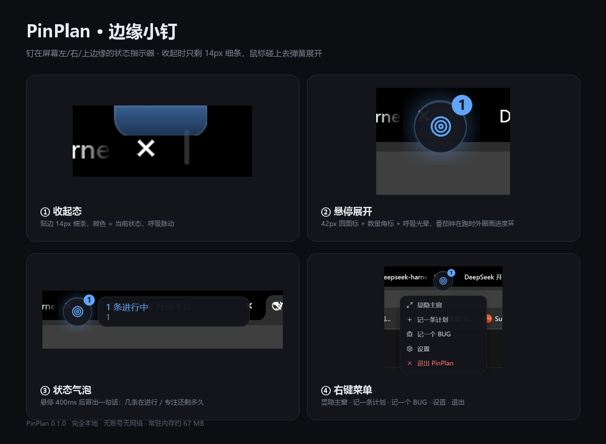

# PinPlan · 钉子计划

钉在屏幕角落的**本地开发计划 / 方案复盘 / BUG 追踪**小工具。

没有账号，没有网络，没有云同步。数据是一个 SQLite 文件，躺在你自己的硬盘上。

---

## 它解决什么

开发中真正会丢的不是代码，是**「我本来打算做什么、做到哪了、为什么放弃」**。

| 能力 | 说明 |
| --- | --- |
| 钉住计划 | 方案随手记，状态一眼看清：草案 / 进行中 / 成功 / 失败 / 搁置 / 放弃 |
| 定时追问 | 番茄钟休息时弹一张小卡片问「这条还在推进吗？」，防止计划悄悄腐烂 |
| 收容 BUG | 记下缺陷，修好点一下标记，留痕可回溯 |
| 完整时间线 | 每次状态变更自动留痕，自动生成开发日志 |

设计上刻意把 **失败** 和 **放弃** 做成一等公民——和成功一样醒目。因为「承认某件事死了」才是这个工具最大的价值。

---

## 四种形态

**① 边缘小钉（Edge Pin）** —— 存在感最低的一层，可以只用它。



贴在屏幕左/右/上边缘，收起时只剩一条 14px 的呼吸细条，鼠标碰上去弹簧展开成圆形小图标。

```
收起态                              展开态（悬停）
                          ▐        ┌──────────────────┐ ┌────┐
     桌面内容              ▐  🔵   │ 3 条进行中        │ │ ◉  │
                          ▐        │ 接入 WebView2…   │ └────┘
                                     └──────────────────┘
                                     状态气泡            状态图标 + 数量角标
```

| 状态色 | 含义 | 呼吸节奏 |
| --- | --- | --- |
| 🔴 红 | 有阻塞/高危 BUG 待修，或有失败还没复盘 | 1.8s 急 |
| 🔵 蓝 | 有进行中条目 / 番茄钟在跑 | 2.6s 稳 |
| 🟢 绿 | 没有待办，今天有成果 | 3.6s 缓 |
| ⚪ 灰 | 还没有记录 | 静止 |

- 悬停 → 从边缘**平移滑出**成圆图标（不缩放、不淡入），停留 400ms 后冒状态气泡
- 单击 → 显隐主窗（不需要再找托盘）
- 右键 → 菜单：显隐主窗 / 记一条计划 / 记一个 BUG / 设置 / 退出
- 拖动 → 离边缘 90px 以内自动吸附；拖到屏幕中间则**自由悬浮**，不再贴边，位置照记
- 巡检到点 → 弹跳一次 + 光环扩散 + 气泡「该巡检了」
- 番茄钟在跑 → 图标外圈画进度环
- 空闲 4 秒 → 自动缩回细条
- 设置里可整体关掉

**② 钉子小窗** 328×468，无边框、圆角、置顶、不进任务栏。

```
┌──────────────────────────────┐
│ 9月8日 周二         ╭──╮ ⤢ ⚙ │  ← 日期 + 成功率环
│ 1 进行 · 0 成功     │ 0│     │
│                     ╰──╯     │
├──────────────────────────────┤
│ ◎ 专注 25:00  ▷ ⇥ ⟲  25′/5′ │  ← 番茄钟
├──────────────────────────────┤
│ [ 计划 1 ] [ BUG ]        🔍 │
├──────────────────────────────┤
│ ▌◐ 接入 WebView2 缓存预热     │  ← 进行中：左侧蓝条呼吸
│    进行中 · 1h 20m · 高       │
├──────────────────────────────┤
│ ＋ 记一条计划…            ↵  │  ← Enter 即记下
└──────────────────────────────┘
```

**③ 展开主窗** 960×640，点 `⤢` 平滑变形。左侧筛选栏 + 中间列表/看板 + 右侧详情与时间线。

**④ 巡检弹窗** 右下角滑入，22 秒后自动收起。

```
┌────────────────────────────────┐
│ ◎ 这条还在推进吗？           ✕ │
│   接入 WebView2 缓存预热        │
│   已进行 1h 20m                │
│  [还在做] [卡住了] [已完成] [放弃] │
│  补一句…（可选）            ↵  │
└────────────────────────────────┘
```

回答**直接回写状态**，不需要打开主窗——这是最高频的交互，必须一秒完成。

---

## 状态机

```
计划：  草案 ──▶ 进行中 ──▶ 成功 / 失败
                 ▲  │
        搁置 ◀───┘  └──▶ 放弃        （都可随时复活）

BUG：   待修 ──▶ 修复中 ──▶ 已修复 ──▶ 已验证
                              │
                              └──▶ 重新打开
```

每条计划分三个字段：**预期 / 实际 / 复盘**。
- 成功 → 记「为什么成，能不能复用」
- 失败 → 记「死在哪一步，下次怎么绕开」

---

## 快捷键

| 键 | 作用 |
| --- | --- |
| `Alt + Space` | 显示 / 隐藏小窗 |
| `Alt + N` | 快速记一条计划 |
| `Alt + B` | 快速记一个 BUG |
| `Enter` | 提交输入框内容 |
| `Esc` | 清空输入 / 关闭弹窗 |

托盘图标左键 = 显隐，右键 = 菜单（含退出）。

---

## 巡检策略（番茄钟 25 + 5）

- 每个番茄（默认 25 分钟）结束、进入休息时，弹一次追问
- 只追问**状态为「进行中」且最久没动过**的那一条，一次只弹一个
- 连续答 2 次「还在做」→ 文案升级为「这条一直没动，要不要先搁置它？」
- 免打扰时段（默认 23:00–09:00）内静默
- 设置里可改时长、开关、免打扰区间，也能点「试一下」立刻预览弹窗

---

## 数据

- 位置：`%APPDATA%\com.pinplan.desktop\pinplan.db`（SQLite）
- 窗口位置和尺寸：同目录 `window.json`
- 边缘小钉的位置与形态：同目录 `dock.json`
- 导出：设置 → 数据 → 导出 Markdown（按状态分组的开发日志，可直接贴周报）或 JSON 全量备份，落在 `我的文档\PinPlan\`

表结构：`project` / `plan` / `bug` / `event` / `checkin` / `setting`，schema 见 `src-tauri/migrations/0001_init.sql`。

---

## 技术栈

| 层 | 选型 | 为什么 |
| --- | --- | --- |
| 外壳 | **Tauri 2** | 安装包 ~10 MB、常驻内存 ~90 MB；置顶/无边框/托盘/全局快捷键/自启都是官方能力 |
| 前端 | React 19 + TypeScript + Vite 8 | — |
| 样式 | Tailwind v4 + 自定义设计 Token | 状态色、圆角、阴影全部走 CSS 变量，换主题不用改组件 |
| 动效 | **Motion**（Framer Motion） | 统一弹簧参数，只跑 `transform`/`opacity`，全程 GPU 合成 |
| 数据 | tauri-plugin-sql + SQLite | 纯本地，migration 在 Rust 侧声明 |
| 质感 | window-vibrancy（Acrylic） | OS 层真实模糊，Web 层只做提亮 + 描边 + 噪点 |

### 动效规范

```ts
spring = { type: 'spring', stiffness: 420, damping: 32, mass: 0.8 }  // 主交互
soft   = { type: 'spring', stiffness: 260, damping: 28 }             // 内容淡入
```

- 列表进出：`layout` + 透明度 + 8px 位移，不做删除后重排
- 状态切换：共享 `layoutId`，卡片在列间「飞」过去
- 进度环：`strokeDashoffset` 弹簧缓动 + 数字等宽
- 弹窗进出**不对称**（进入 260ms 弹簧 / 退出 180ms ease-out），才不拖沓
- `prefers-reduced-motion` 下全部退化为淡入淡出

### 目录

```
src/
  lib/        db.ts  repo.ts  types.ts  time.ts  bus.ts  export.ts
              dock.ts  status.ts  window.ts  useNow.ts  app.ts
  store/      useStore.ts        # zustand，含番茄钟引擎与巡检调度
  components/ PlanRow BugRow ListView BoardView DetailPanel SettingsPanel …
  windows/    WidgetApp.tsx      # 主窗（小窗 / 展开两态）
              PopupApp.tsx       # 巡检弹窗
              DockApp.tsx        # 边缘小钉
  styles/     global.css         # 设计系统
src-tauri/
  src/lib.rs                     # 窗口/托盘/快捷键/导出/小钉几何命令
  src/winstate.rs                # 位置记忆（700ms 合并写入）
  migrations/0001_init.sql
docs/DESIGN.md                   # 完整设计文档
scripts/                         # 图标生成、截图自检
```

---

## 性能

窗口拖动跟手度是这类常驻小工具的关键指标。用两种方式实测：`SetWindowPos + DwmFlush`（合成耗时）和**真实模态拖拽模拟**（进入 Windows 拖拽循环后量整棵进程树的 CPU）。

| 指标 | 修复前 | 修复后 |
| --- | --- | --- |
| 空闲 CPU（整棵树） | 0.28 核 | **0.003 核** |
| 真实拖拽期间 CPU | 0.65 核 | **0.15 核** |
| 移动 + 上屏耗时 | 14.9 ms | 7.3 ms |

### 根因与做法

**根因不是「拖拽逻辑慢」，而是循环动画让渲染进程每帧都在产帧、持续向 DWM 提交**；而 Windows 10 上「透明窗口 + 亚克力」每提交一帧都要重新模糊合成一次，两者叠加就卡。

彻底修复分四步：

1. **去掉整窗容器上的 `backdrop-filter`** —— 透明窗口背后没有东西可模糊，纯开销
2. **去掉噪点层的 `mix-blend-mode: overlay`** —— 整窗每帧重混合
3. **删除全部无限循环动画**（状态点呼吸、进行中竖条脉动、番茄钟图标呼吸、小钉光晕呼吸）—— 改成静态颜色 + 静态光晕，状态仍由颜色表达，只是不再动
4. **位置记忆移到后台线程** —— 事件线程只计数，静止后才读几何

> 注意：拖拽期间**不要试图用 JS/Rust 检测「正在拖动」然后暂停动画**——Windows 的拖拽是模态循环，主线程被占住，`Moved` 事件和 IPC 都要等松手后才分发，那种方案根本来不及生效。正确做法就是**一开始就不让动画存在**。

另外，窗口玻璃底可在设置里切换（**亚克力 / 模糊 / 关闭**）。亚克力在拖动时仍会让 DWM 每帧重模糊（约 +1 帧），在**虚拟显示器 / 远程桌面驱动**（ToDesk、向日葵、MuMu 虚拟显示）上会更明显——如果你拖窗口仍然觉得不够跟手，切到「模糊」或「关闭」即可彻底消除。

---

## 开发

```bash
pnpm install
pnpm app:dev        # 开发模式（热更新）
pnpm build          # 只构建前端
pnpm app:build      # 打包 → src-tauri/target/release/bundle/nsis/
```

需要 Node 18+、Rust 1.77+、Windows 10/11（WebView2 已随系统预装）。

---

## 已知取舍

- **Windows 10 没有 Mica**，用的是 Acrylic；圆角靠 Web 层 CSS 实现，窗口四角会露出极小的模糊三角形（Win11 上由系统处理，无此现象）
- **边缘小钉刻意不用系统亚克力**：它的窗口要在「细条 / 图标 / 气泡」三种尺寸间切换，亚克力会把整块窗口矩形都染色，露出多余暗块。所以小钉的质感由 Web 层自己画（实底 + 描边 + 静态光晕），窗口是纯透明的——桌面内容会透过图标周围的空白区域
- **窗口玻璃可切换**：亚克力 / 模糊 / 关闭。多虚拟显示适配器或远程桌面环境下建议降级，见上面的「性能」一节
- 小钉气泡展开时窗口会临时变宽，那一片区域在气泡显示的 2.6 秒内会挡住下层窗口的点击；气泡消失、窗口缩回后即恢复
- 看板拖拽用的是原生 HTML5 DnD 而非 dnd-kit —— 单窗口 4 列的场景下够顺滑，少一层依赖
- 番茄钟在前端计时，窗口隐藏时依然运行；如果彻底退出进程则计时重置（已完成番茄数会保留）
